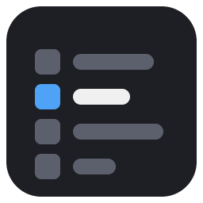

# Deck Overview

Every deck in the current view on one page: **Mod Menu > Community Mods > Installed >
Deck Overview**.



## Using it

Each deck gets a row with:

- its number,
- its BPM (with pitch), or `--` when the deck does not report one,
- the difference to the **reference deck**, in BPM and percent (`+1.25  +0.9%`), and
- the loaded file's name, or *No track*.

The reference deck is highlighted. Turn the browse knob, or tap a deck, to make it the
reference; your choice is remembered. Differences are shown only when both decks report a
BPM, and none at all when the reference deck is outside the current view (deck 3 or 4 in
the 2-deck view), until you pick another.

The name is what the core's `deck_title` reports: the loaded file's name without its
extension when the core knows it, otherwise the track's title from the library.

## What it shows

| Service | Where |
|---|---|
| `deck_count`, `deck_loaded`, `deck_bpm`, `deck_title` | one row per deck in the current view |
| `register_screen` and the drawing services | the page |
| `cfg_get`, `cfg_set` | the reference deck, remembered |
| `request_redraw` | from `tick()`, only when a shown value changes, at most every 250 ms by the monotonic clock |

## What it changes

Nothing on the deck. It only reads deck state through the AZ-MODS core and keeps one
setting (the reference deck) in `MODS/azmods.cfg` on the USB. No hooks, no files of its own,
no network, no LEDs, controls or audio.

## Build

From the repository root, with the SDK beside it:

```sh
../az-mods-sdk/tools/azmod-pack build deck-overview
```

It needs the 1.2.3 SDK or newer.

## License

GPL-3.0-only. See [LICENSE](LICENSE).
